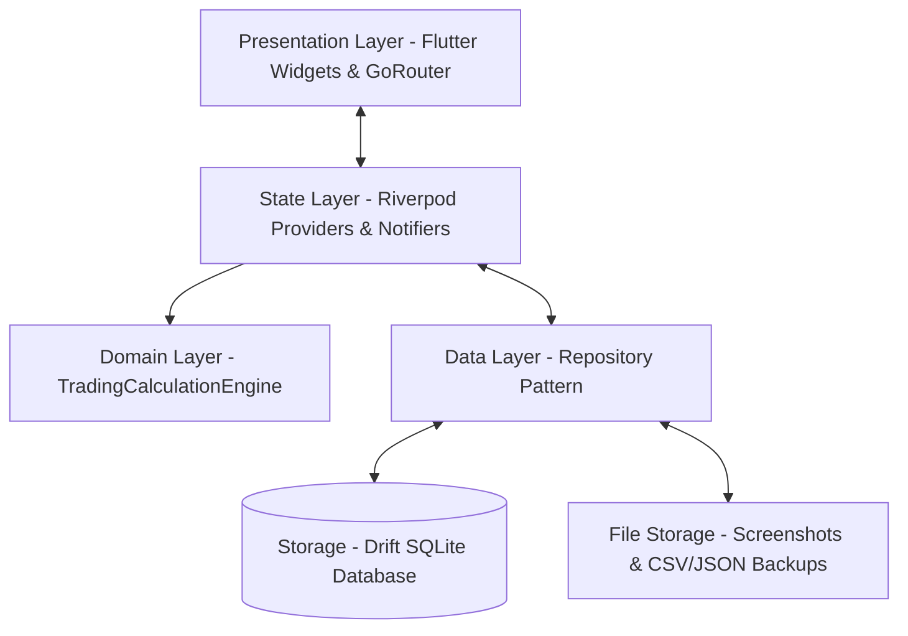
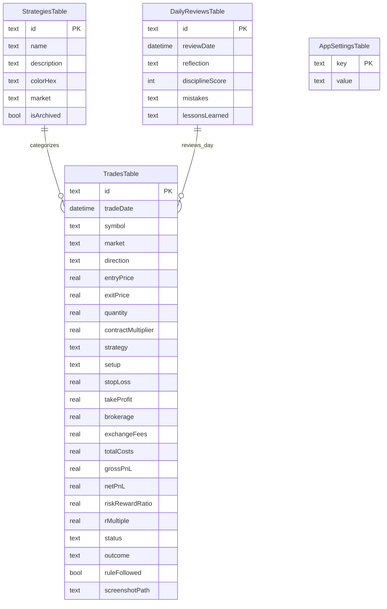

# Software Requirements Specification (SRS)
## Trade Track (Offline Trading Journal & Analytics Platform)

**Document Version:** 1.0.0  
**Status:** Verified & Released  
**Target Application:** Trade Track  
**Platform:** Flutter (Android, iOS, Desktop)  

---

## 1. Introduction

### 1.1 Purpose
This Software Requirements Specification (SRS) document provides a complete description of the system architecture, functional requirements, data models, non-functional requirements, and operating constraints for **Trade Track**. It serves as the formal technical baseline for developers, product managers, and software testers.

### 1.2 Scope
**Trade Track** is an offline-first, private financial journal engineered for equity, commodity (MCX/NSE/BSE), and forex traders. The application records trading executions, computes mathematical and psychological metrics in real time (Gross/Net P&L, Risk-to-Reward ratio, R-Multiple, Expectancy, Maximum Drawdown), presents dynamic interactive visualizations, and enables daily performance retrospectives with calendar heatmaps.

### 1.3 Key Definitions & Acronyms
| Term | Definition |
| :--- | :--- |
| **Gross P&L** | Profit or Loss calculated as `(Exit Price - Entry Price) × Quantity × Multiplier` before fees. |
| **Net P&L** | `Gross P&L - Total Costs` (Brokerage + Exchange Fees + Spread + Other Fees). |
| **R:R** | Planned Risk-to-Reward Ratio: `Planned Reward / Planned Risk`. |
| **R-Multiple** | Realized reward multiple relative to initial dollar risk: `Net P&L / Initial Planned Risk`. |
| **Expectancy** | `(Win Rate × Avg Win) - (Loss Rate × Avg Loss)`. Expected monetary gain per trade. |
| **Max Drawdown** | The maximum peak-to-trough decline in account balance during a specific evaluation period. |
| **Drift** | A type-safe reactive persistence library for SQLite in Flutter. |
| **Riverpod** | Compile-safe, testable state management framework for Flutter. |

---

## 2. Overall Description

### 2.1 Product Perspective
Trade Track is a standalone, client-side application. Unlike cloud-dependent trading platforms, all database records, chart assets, and analytical computations execute entirely on the local device. There is zero external server communication, eliminating latency and guaranteeing complete financial privacy.

### 2.2 System Architecture & Technology Stack
- **Framework**: Flutter 3.47+ (Dart 3.x)
- **Design System**: Luxury Onyx & Gold dark theme (`AppColors`, Material 3 design tokens)
- **State Management**: `flutter_riverpod` (v2.6.1)
- **Local Persistence**: `drift` (v2.35.2) with `sqlite3_flutter_libs`
- **Routing**: `go_router` (v18.1.0) with `StatefulShellRoute.indexedStack`
- **Data Visualizations**: `fl_chart` (v1.2.0)
- **Shared Preferences**: `shared_preferences` (v2.5.6)
- **System Utilities**: `share_plus`, `file_picker`, `image_picker`, `intl`, `uuid`, `csv`

---

## 3. Current Implementation & Status

| Phase | Milestone | Current Status | Notes |
| :--- | :--- | :--- | :--- |
| **Core Architecture** | Repository, Engine, Database | ✅ Complete | In-memory & SQLite tests passing (100%) |
| **Static Analysis** | Linting & Linter Rules | ✅ 0 Issues | `flutter analyze` clean with 0 warnings |
| **Test Suite** | Unit, Widget & Integration | ✅ 24/24 Passed | 100% test pass rate across engine & db |
| **Android Packaging** | Release APK Assembly | ✅ Verified | Release APK generated (`66.4 MB`) |
| **Hardware Deployment**| Physical Device Installation | ✅ Verified | Installed and verified on Samsung Galaxy SM-M176B |
| **Branding & Identity**| App Icon & Launcher Label | ✅ Complete | Gold candlestick icon & "Trade Track" label |

---

## 4. Functional Requirements Specification

### 4.1 Module 1: Splash & Initial Onboarding
- **FR-1.1 Splash Screen**:
  - Displays high-resolution luxury emblem, bull & bear artwork, and brand typography.
  - Inspects `hasCompletedOnboarding` state from persistent settings to route to `/dashboard` or `/onboarding`.
- **FR-1.2 Onboarding Workflow**:
  - Educational feature carousels highlighting trade logging, performance analytics, and local privacy.
  - Initial configuration of **Default Currency** (₹ INR, $ USD, € EUR, £ GBP).
  - Initial configuration of **Default Market** (NSE India or Forex).
  - Setting **Initial Starting Capital** with instantaneous validation.

### 4.2 Module 2: Executive Dashboard
- **FR-2.1 KPI Metric Cards (2×2 Grid)**:
  - **Net P&L**: Color-coded (+ green / - red) with dynamic return percentage badge.
  - **Win Rate**: Percentage of profitable closed trades.
  - **Profit Factor**: Gross Profit divided by Gross Loss (displays `∞` when 0 losses exist).
  - **Total Trades**: Total number of completed orders.
- **FR-2.2 Cumulative Equity Curve**:
  - Dynamic interactive line chart plotting cumulative net P&L progression over chronologically sequenced trades.
  - Visual baseline markers, gradient fills, and custom touch tooltips showing date and realized value.
- **FR-2.3 Daily P&L Histogram**:
  - Bar chart summarizing individual daily net outcomes across the active filter window.
- **FR-2.4 Date Range Filter**:
  - Instantaneous switching between *Today*, *This Week*, *This Month*, *Last 30 Days*, *Last 3 Months*, *This Year*, *All Time*, and *Custom Date Range Picker*.

### 4.3 Module 3: Trade Journal & Multi-Filtering
- **FR-3.1 Real-Time Search**: Sub-string filtering across symbol, setup description, strategy, and notes.
- **FR-3.2 Quick Market Filters**: Rapid toggle pills (*All*, *NSE*, *Forex*).
- **FR-3.3 Advanced Filter Bottom Sheet**:
  - Filter by Strategy (multi-select).
  - Filter by Outcome (*Win*, *Loss*, *Breakeven*, *Open*).
  - Filter by Trade Status (*Open*, *Closed*).
- **FR-3.4 Trade Card Component**:
  - Symbol & Market badge avatar.
  - Date and execution timestamp.
  - Net P&L with sign-prefixed currency formatting.
  - Planned R:R and realized R-Multiple tags.
  - Rule adherence indicator (*Rule Followed* vs *Rule Broken*).

### 4.4 Module 4: Order Entry & Real-Time Calculation Engine
- **FR-4.1 Core Parameters**:
  - Symbol input with auto-capitalization.
  - Market selector (*NSE*, *Forex*).
  - Trade Direction toggle (*Buy / Long* vs *Sell / Short*).
  - Trade Status toggle (*Closed* vs *Open*).
  - Entry Price, Exit Price (optional if open), Quantity, and Contract Multiplier.
- **FR-4.2 Automated Real-Time Math**:
  $$\text{Gross P\&L} = (\text{Exit Price} - \text{Entry Price}) \times \text{Quantity} \times \text{Multiplier} \quad (\text{for Long})$$
  $$\text{Gross P\&L} = (\text{Entry Price} - \text{Exit Price}) \times \text{Quantity} \times \text{Multiplier} \quad (\text{for Short})$$
  $$\text{Total Costs} = \text{Brokerage} + \text{Exchange Fees} + \text{Spread} + \text{Other}$$
  $$\text{Net P\&L} = \text{Gross P\&L} - \text{Total Costs}$$
  $$\text{Planned Risk} = |\text{Entry Price} - \text{Stop Loss}| \times \text{Quantity} \times \text{Multiplier}$$
  $$\text{Planned Reward} = |\text{Take Profit} - \text{Entry Price}| \times \text{Quantity} \times \text{Multiplier}$$
  $$\text{Risk to Reward Ratio} = \frac{\text{Planned Reward}}{\text{Planned Risk}}$$
  $$\text{R-Multiple} = \frac{\text{Net P\&L}}{\text{Planned Risk}}$$
- **FR-4.3 Psychological & Behavioral Logging**:
  - Pre-trade and post-trade emotional state selector.
  - Rule Followed compliance toggle.
  - Mistake categorization and lessons learned inputs.
- **FR-4.4 Visual Attachments**:
  - Gallery and camera chart screenshot picker with local image caching and preview thumbnails.

### 4.5 Module 5: Trade Details & Order Management
- **FR-5.1 Detailed Execution Breakdown**:
  - Full financial recap: Entry, Exit, Net P&L, Gross P&L, Total Costs breakdown.
  - Planned parameters vs realized performance.
- **FR-5.2 Psychological Review Card**:
  - Emotions, discipline adherence, mistake reflections.
- **FR-5.3 Fullscreen Chart Viewer**:
  - Pinch-to-zoom chart viewer for attached setup screenshots.
- **FR-5.4 Actions**:
  - Modify Trade (pre-populates form) and Delete Trade with confirmation dialog.

### 4.6 Module 6: Advanced Analytics
- **FR-6.1 Timeframe Window**: 1M, 3M, 6M, 1Y, and All-Time performance aggregation.
- **FR-6.2 Win/Loss/Breakeven Distribution**:
  - Donut chart with center trade counter and proportional breakdown of Wins, Losses, and Breakeven trades.
- **FR-6.3 Strategy Leaderboard**:
  - Strategy table sorting strategies by Net P&L, Win Rate, and Trade Count.
- **FR-6.4 Advanced Performance Statistics**:
  - Average Winner ($)
  - Average Loser ($)
  - Expectancy ($/trade)
  - Maximum Drawdown ($ and %)
  - Profit Factor

### 4.7 Module 7: Daily Review & Calendar Heatmap
- **FR-7.1 Calendar Heatmap**:
  - Month calendar grid with color-coded day cells: Green for net profitable days, Red for net loss days, Gray for inactive days.
- **FR-7.2 Daily Journaling**:
  - 1–5 Star Discipline Score rating.
  - Text reflections: What went well, What mistakes occurred, Key takeaways.
- **FR-7.3 Execution Listing**:
  - Filtered list of all individual orders executed on the selected date.

### 4.8 Module 8: Strategy Manager & Data Governance
- **FR-8.1 Strategy CRUD**: Create, edit, archive, and delete custom strategies with unique hex colors and target markets.
- **FR-8.2 CSV Export**: Export trades to RFC 4180-compliant CSV files.
- **FR-8.3 JSON Backup & Restore**: Full database backup generation and file-picker-based restore with conflict handling.
- **FR-8.4 Reseed & Reset**: Ability to wipe data or reseed high-quality demo data for demonstration purposes.

---

## 5. Non-Functional Requirements (NFR)

### 5.1 Performance & Responsiveness
- **Rendering**: Consistent 60 FPS / 120 FPS frame rate utilizing Impeller Vulkan engine on Android.
- **Cold Start Time**: Launch to interactive UI under 1.2 seconds on standard mobile hardware.
- **Database Query Latency**: Less than 15ms for journal querying and aggregations up to 5,000 trades.

### 5.2 Security & Data Privacy
- **Local Isolation**: All user financial records, journals, and chart images reside strictly on the local device sandbox.
- **No Third-Party Telemetry**: Zero analytics SDKs, ad networks, or cloud trackers.

### 5.3 Reliability & Fault Tolerance
- **Database Atomicity**: ACID-compliant transactions via SQLite/Drift for multi-table operations.
- **Error Boundaries**: Try-catch encapsulated bootstrap sequence guaranteeing app display even in edge corruption cases.

---

## 6. Database Entity Relationship Model

---

## 7. Verification & Test Suite Summary

The application includes an automated test suite across four test tiers:

1. **Calculation Engine Tests** (`test/trading_calculation_engine_test.dart`):
   - Verifies Long/Short gross & net P&L calculations.
   - Verifies fee summation and breakeven threshold logic.
   - Validates planned risk, reward, R:R ratio, and R-Multiple.
   - Tests expectancy, win-rate, and max drawdown algorithms.
   - Tests edge cases: 0 quantity, missing exit prices, zero planned risk.

2. **Database Integration Tests** (`test/database_test.dart`):
   - In-memory Drift SQLite testing for trade insertion, retrieval, update, and deletion.
   - Strategy CRUD and daily review date querying.
   - Batch operations and database reset functionality.

3. **Formatters & Utilities Tests** (`test/utils_test.dart`):
   - Currency formatting with Indian numbering format (Cr, L, K) and international currencies.
   - DateTime formatting and day-boundary computations.

4. **Widget UI Tests** (`test/widget_test.dart`):
   - Interactive gold button tap and rendering tests.
   - Financial metric card value, sign, and badge rendering tests.
   - Status badge styling across all trade outcome states.
